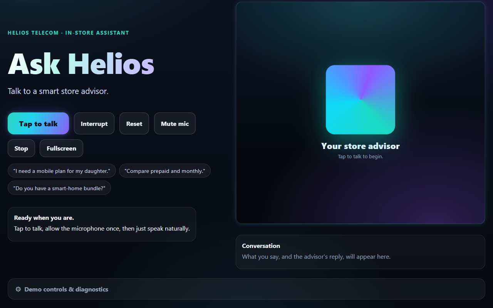

# Avatar kiosk starter

A talking avatar for a store kiosk. A customer walks up, asks a question out loud and gets a spoken answer from an Azure avatar, with product cards on the screen next to it. It runs in the browser on Azure Voice Live and the Azure Speech avatar, and you deploy it to your own Azure subscription.

The store in the box is Helios Telecom, a fictional mobile operator. Swap in your own brand and product catalogue to make it yours.

**This is a personal prototype, not a Microsoft product.** You pay for the Azure resources you create, so read [Costs](#costs) before you deploy.



## What you get

- A realtime avatar on Azure Voice Live. It listens continuously, handles interruptions and runs noise suppression and echo cancellation on the server side.
- A fallback on the Azure Speech avatar, for when Voice Live isn't set up yet.
- A Node.js broker on Express that keeps every Azure key on the server. The browser only gets short-lived tokens and WebRTC details.
- Guardrails that keep the avatar on topic and hand account, payment and identity questions to a person in the store.
- A mock assistant and a small catalogue. The kiosk answers before you connect a real backend.
- A noise test harness that shows microphone levels and exports test results as JSON.
- Bicep and a deploy script. Everything lands in one resource group.

## How it works

```text
Kiosk browser: microphone, avatar video, product cards
   |  audio over WebSocket, avatar media over WebRTC
   v
Express broker on Azure App Service: keys, guardrails, catalogue
   |
   +--> Azure Voice Live: realtime model, voice and avatar
   +--> Azure Speech: avatar fallback and speech tokens
   +--> Your assistant API (optional)
```

More detail in [docs/architecture.md](docs/architecture.md) and [docs/voice-live.md](docs/voice-live.md).

## Run it locally

You need Node.js 22 or later.

```powershell
copy .env.example .env
npm install
npm run dev
```

Open the URL the terminal prints. Without Azure keys the kiosk runs in mock mode: the UI, the catalogue, the guardrails and typed questions all work, but there's no avatar. Add the Speech and Voice Live values to `.env` to bring the avatar in. Browsers allow the microphone on localhost.

## Deploy to Azure

You need the Azure CLI, Node.js 22 and a subscription where you can create resources.

```powershell
az login
.\scripts\deploy.ps1 -SubscriptionId <your-subscription-id> -PrototypeAccessPassword (Read-Host 'Access password' -AsSecureString)
```

The script creates the resource group `rg-avatar-kiosk` with:

- a Linux App Service plan (Basic B1) and a web app
- an Azure Speech resource
- an Azure AI Services resource for Voice Live
- Application Insights and a Log Analytics workspace

Then it builds the app, deploys it as a zip package and prints the URL. The template copies the keys from the resources straight into the app settings, so you never handle a secret.

By default the web app and Speech run in West Europe and Voice Live runs in Sweden Central. Change that in `infra/main.parameters.json`, and check the [region table](https://learn.microsoft.com/azure/ai-services/speech-service/regions) for Voice Live and avatar support first.

Set an access password before you share the URL. It's a simple gate for a prototype, so don't treat it as sign-in.

Already have a Voice Live resource? Set `provisionVoiceLive` to `false`, fill in `voiceLiveEndpoint` and pass `-VoiceLiveApiKey (Read-Host -AsSecureString)`.

The scripts are written for PowerShell and tested on Windows.

## Costs

- The App Service plan is billed every hour until you delete it, whether anyone talks to the kiosk or not.
- Avatar and Voice Live sessions are billed for the minutes and tokens they use. This is the part that grows when people use it.
- Speech, Application Insights and Log Analytics charge by use, which stays small for a test.

Check current prices in the [Azure pricing calculator](https://azure.microsoft.com/pricing/calculator/) and delete everything when you're done.

## Clean up

```powershell
.\scripts\cleanup.ps1 -SubscriptionId <your-subscription-id>
```

Azure keeps deleted Speech and AI Services resources soft-deleted for 48 hours. To redeploy with the same names before that, list them with `az cognitiveservices account list-deleted` and remove them with `az cognitiveservices account purge`.

## Make it yours

- **Brand:** copy `branding/_template.json`, fill it in and point `BRAND_CONFIG_FILE` at it. See [branding/README.md](branding/README.md).
- **Catalogue:** replace the fictional products in `src/server/kioskKnowledge.ts` with your own. The Voice Live avatar and the mock assistant both use it.
- **Assistant:** set `ASSISTANT_API_URL` to answer typed questions and the Speech avatar fallback from your own backend. In Voice Live mode the realtime model answers itself, guided by the instructions in `src/server/voiceLiveSession.ts`. The request and response shapes are in [docs/assistant-integration-contract.md](docs/assistant-integration-contract.md).
- **Voice and avatar:** change the voice and the avatar character in `infra/main.parameters.json` or in the app settings.

## Test it where it will stand

A quiet office tells you little about a busy store. The kiosk has a test harness with fixed phrases, microphone levels and an evidence export. Start with [docs/validation-guide.md](docs/validation-guide.md), track results in [docs/evidence-checklist.md](docs/evidence-checklist.md) and use [docs/demo-guide.md](docs/demo-guide.md) when you show it to others.

## Before you put it in a real store

- There's no Entra ID sign-in, API Management or private networking. Add them before production.
- The kiosk doesn't show a privacy notice yet. The brand file has a `privacyNotice` field, but the UI doesn't display it. Decide what you tell customers about voice and transcripts before anyone talks to it.
- The Helios products are fictional. Replace them before real customers see the kiosk.

## Check your changes

```powershell
npm run build
npm start
```

Then, in a second terminal:

```powershell
.\scripts\smoke-test.ps1 -BaseUrl http://localhost:3000
```

The smoke test needs PowerShell 7. GitHub Actions runs the same build and smoke test in mock mode on every push.

## License

MIT. See [LICENSE](LICENSE).
